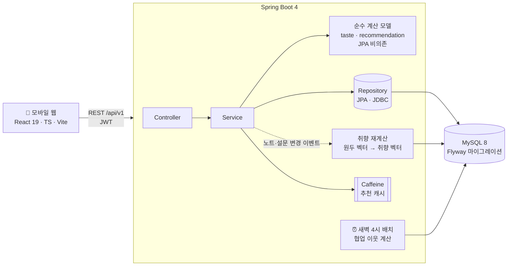
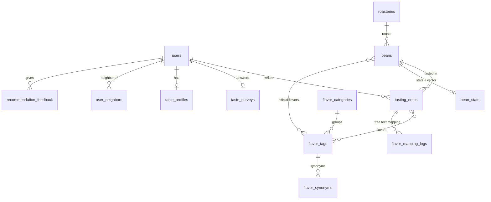

<div align="center">

# ☕ Beanote

**마신 커피를 기록하면 취향을 숫자로 보여주고, 다음에 마실 원두를 이유와 함께 추천하는 서비스**

[](https://github.com/HaeseokPark/beannote/actions/workflows/ci.yml)


</div>

<br/>

## 📌 한눈에 보기

| 항목 | 내용 |
|---|---|
| 추천 품질 | 오프라인 평가 **NDCG@10 인기순 0.049 → 혼합 추천 0.105 (+111%)** · 가상 데이터, 누수 없는 시간순 분할 |
| 응답 속도 | 원두 1,000 · 사용자 1,000 · 노트 1만 기준 추천 API **p95 65.6ms** (캐시 히트 9.7ms) |
| 향미 표준화 | 표기 변형 · 오타 · 문장 속 표현 54개 말뭉치 정확도 **98.1%** |
| 테스트 | **115개** (실제 MySQL 통합 테스트, 권한 규칙 · N+1 · 추천 규칙 고정) · GitHub Actions CI |
| 문서 | 기능 · 데이터 모델 · API · 개발 단계를 담은 [기획서](PLANNING.md), [추천 평가 리포트](reports/recommendation-eval.md), [성능 리포트](reports/recommendation-perf.md), [향미 매핑 리포트](reports/flavor-mapping.md) |

<br/>

## 🤔 해결하려는 문제

- 스페셜티 원두는 원산지 · 가공 · 로스팅에 따라 맛이 크게 다르지만, 소비자는 **"내가 어떤 맛을 좋아하는지"를 말로 설명하기 어렵습니다.**
- 로스터리마다 향미 표현이 제각각이라("자스민", "꽃향", "플로럴") **원두끼리 비교하기 어렵습니다.**
- 기존 커피 기록 앱은 메모장 수준이라, 기록이 쌓여도 **다음 선택에 도움이 되지 않습니다.**

Beanote는 시음 노트를 **구조화된 데이터**로 받아 취향 벡터를 만들고, 그 벡터로 **설명 가능한 추천**을 합니다.

<br/>

## ✨ 핵심 기능

| 기능 | 설명 |
|---|---|
| 📝 **단계형 시음 노트** | 원두 → 추출 · 레시피 → 맛 5축(점수마다 쉬운 설명) → 향미 태그 → 0.5 단위 별점 · 메모 · 공개 범위. 작성 중 임시 저장 |
| 🎯 **설명 가능한 추천** | 상위 10개 원두와 "좋아하시는 밝은 산미가 특징이에요" 같은 근거 문장. 관심 없음 / 이미 마셔봄 피드백 |
| 📊 **취향 프로필** | 맛 레이더, 선호 · 비선호 향, 가공 · 원산지 · 로스팅별 평균 별점, 취향 신뢰도(설문 기반 → 형성 중 → 안정) |
| 🌸 **향미 표현 표준화** | "살짝 자두 같은 느낌", "쟈스민", "블루베라"를 표준 태그로. 애매한 표현은 검토 대상으로 분리 |
| 🧊 **콜드스타트** | 3단계 온보딩 설문으로 노트 0개에서도 추천. 설문을 건너뛰면 인기순 |
| 🔍 **원두 찾기 · 등록** | 검색 · 향미 · 가공 · 로스팅 필터 · 인기 / 평점 정렬, 비슷한 원두, 중복 후보를 먼저 보여주는 원두 등록 |

<br/>

## 🛠 기술적으로 고민한 지점

### 1. 스스로 채점하지 않는 오프라인 평가
가상 평점이 원두 벡터에서만 나오면 콘텐츠 기반 추천이 당연히 이깁니다(순환 평가). 그래서 가상 데이터에 **추천기가 볼 수 없는 요인**을 넣었습니다.

- 취향 유형마다 **숨은 원산지 선호** (원산지는 원두 벡터에 없음) · 사람마다 다른 향미 선호 · 평점 습관(후하게/짜게) · 잡음 · 선택 편향
- 최근 20%를 **시간순으로 숨기고**, 원두 벡터 · 취향 벡터 · 이웃을 **남은 학습 데이터만으로** 계산 (누수 방지)
- 운영 코드와 **같은 계산 클래스**(`BeanVectorCalculator`, `TasteVectorCalculator`, `NeighborFinder`, `CollabScorer`, `RecommendationScorer`)를 그대로 사용

| 방법 | Precision@5 | Recall@10 | NDCG@10 | 인기순 대비 |
|---|---|---|---|---|
| 무작위 | 0.008 | 0.037 | 0.020 | −60% |
| 인기순 (기준) | 0.021 | 0.079 | 0.049 | — |
| 평균 평점순 | 0.016 | 0.078 | 0.045 | −8% |
| 콘텐츠 기반 단독 | 0.024 | 0.121 | 0.064 | +29% |
| 협업 필터링 단독 | 0.044 | 0.220 | 0.126 | +154% |
| **혼합 (콘텐츠 + 협업)** | **0.038** | **0.175** | **0.105** | **+111%** |

> 원두 300개 · 사용자 약 300명 · 시드 3개 평균. **가상 데이터 결과이며 실제 사용자 만족도가 아닙니다.**

**예상과 다른 결과도 기록했습니다.** 협업 단독이 혼합보다 높게 나와 숨은 요인을 없앤 비교 실험을 추가했고, 그래도 협업이 앞서는 원인이 **"미디엄 로스팅을 좋아함"처럼 가운데 값을 좋아하는 선호를 코사인 유사도가 표현하지 못하기 때문**임을 확인했습니다. 가중치는 가상 데이터에 맞추지 않고 실제 데이터로 다시 평가한 뒤 조정합니다. → [평가 리포트](reports/recommendation-eval.md)

### 2. 평점 기준이 다른 사람을 같은 기준으로
```
wᵢ = (평점ᵢ − 사용자 평균 평점) × 0.97^(경과 일수ᵢ / 7)
tasteVector = Σ (wᵢ × beanVectorᵢ) / Σ |wᵢ|
```
짜게 주는 사람(3, 4, 5점)과 후하게 주는 사람(4, 4.5, 5점)이 같은 순서로 평가하면 **같은 취향 벡터**가 나옵니다. 모든 별점이 같아 Σ|w| = 0이 되는 경우, 설문과 노트를 섞는 구간(노트 3~9개)까지 단위 테스트로 고정했습니다. 협업 점수도 이웃의 "본인 평균 대비 평점"을 씁니다.

### 3. 낮은 값을 좋아하는 취향도 계산에 반영
기획서의 0~1 인코딩으로는 "쓴맛을 싫어함"이 내적에 전혀 반영되지 않았습니다. 맛 축과 로스팅을 **가운데가 0인 −1~1**로 바꾸고, 향미 10차원이 유사도를 지배하지 않도록 **구간별 가중치**(맛 1.0 · 향미 0.6 · 가공 0.4 · 로스팅 0.8)를 설정값으로 뒀습니다. → [기획서 5-7](PLANNING.md)

### 4. LLM 없이 설명 가능한 추천
가중 코사인 유사도를 **차원별 기여도로 분해**해 상위 2개를 템플릿 문장으로 바꿉니다. 같은 입력이면 같은 이유가 나와 테스트할 수 있고, 한국어 조사(이/가, 이에요/예요)도 받침에 맞춰 처리합니다.

### 5. 향미 표현 표준화 4단계 판정
`EXACT`(사전 일치) → `AUTO`(꼬리말 제거 · 자모 단위 편집 거리 85점 이상) → `REVIEW`(70~85점) → `UNMAPPED`. 한글을 **자모로 분해**해 "자스밍 → 자스민" 같은 받침 하나 차이를 잡고, "리치한(rich)"처럼 단어 안에 포함되기만 한 표현은 과일 리치로 확정하지 않고 검토 대상으로 보냅니다. → [매핑 리포트](reports/flavor-mapping.md)

### 6. 캐시 무효화 시점
추천 결과는 30분 캐시(Caffeine)하고, 본인 노트 · 설문 · 피드백이 바뀌면 무효화합니다. 이때 **트랜잭션 커밋 뒤에** 지워서, 커밋 전에 들어온 요청이 옛 데이터로 캐시를 다시 채우는 경쟁을 막았습니다.

### 7. 권한과 토큰
- 비공개 노트를 남이 조회하면 **없는 노트와 똑같은 응답**(`NOTE_NOT_FOUND`)을 줘 존재 여부를 드러내지 않습니다 (응답 본문까지 같은지 테스트).
- Refresh 토큰은 **해시로만 저장**하고 재발급 때 교체하며, 폐기된 토큰이 다시 쓰이면 탈취로 보고 그 사용자의 토큰을 모두 폐기합니다.
- 로그인 시도 제한(IP · 계정별 5분 10회).

### 8. 쿼리 수 고정
목록 API는 페이지 크기가 커져도 **쿼리 수가 늘지 않는 것**을 Hibernate 통계로 검증합니다(N+1 테스트). 원두 통계는 노트가 바뀔 때 **집계 SQL 한 번**(`INSERT … SELECT … ON DUPLICATE KEY UPDATE`)으로 다시 계산합니다.

<br/>

## 🏗 아키텍처



- 추천 계산 로직(`taste.model`, `recommendation.model`)은 **JPA 엔티티에 의존하지 않는 순수 클래스**라 단위 테스트와 오프라인 평가에서 그대로 재사용합니다.
- 노트 · 설문이 바뀌면 이벤트로 원두 벡터 → 취향 벡터를 같은 트랜잭션에서 다시 계산합니다. 비동기 처리로 옮길 때 이벤트를 그대로 씁니다.

### 주요 테이블



<br/>

## 🚀 실행 방법

### 준비물
- Java 21, Node.js 20+, MySQL 8 (로컬 설치, Docker 없이 동작)

### 1. DB 만들기 (최초 1회)
```bash
mysql -u root -p < scripts/db/init-local.sql
```
`beanote`(개발용) · `beanote_test`(테스트용) DB와 로컬 전용 계정을 만듭니다.

### 2. 백엔드
```bash
cd backend
cp .env.example .env          # JWT_SECRET 에 32바이트 이상 임의 문자열 입력
./gradlew bootRun             # http://localhost:8080
```
- 실행 시 Flyway가 스키마와 시드 데이터(로스터리 12곳 · 원두 60개 · 향미 태그 50개 · 동의어 200개)를 만듭니다.
- API 문서: http://localhost:8080/swagger-ui.html

### 3. 프론트엔드
```bash
cd frontend
npm install
npm run dev                   # http://localhost:5173 (API 는 8080 으로 프록시)
```

### 테스트
```bash
cd backend
./gradlew test                # 통합 테스트 + 오프라인 평가 (reports/ 갱신)
./gradlew perfTest            # 추천 API 응답 시간 측정 (원두 1,000 · 사용자 1,000, 약 2분)
```

<br/>

## 📁 프로젝트 구조

```
beannote/
├─ PLANNING.md                    # 기획서 (기능 · 데이터 모델 · API · 개발 단계 · 결정 기록)
├─ backend/src/main/java/com/beanote/
│  ├─ global/                     # 공통 응답 · 예외 · 보안(JWT) · 요청 ID 로깅
│  ├─ auth/ user/                 # 회원가입 · 로그인 · 토큰 재발급
│  ├─ bean/ roastery/             # 원두 카탈로그 · 검색 · 등록 · 통계
│  ├─ flavor/                     # 향미 태그 · 동의어 · 표준화(matching/)
│  ├─ note/                       # 시음 노트
│  ├─ survey/                     # 온보딩 설문
│  ├─ taste/                      # 원두 · 취향 벡터 (model/ = 순수 계산)
│  └─ recommendation/             # 점수 · 이유 · 협업 이웃 · 캐시 (model/ = 순수 계산)
├─ backend/src/main/resources/db/migration/   # Flyway V1 ~ V9
├─ frontend/src/                  # pages · components · api · styles
├─ reports/                       # 평가 · 성능 · 향미 매핑 리포트 (테스트가 자동 생성)
└─ scripts/db/                    # 로컬 DB 초기화
```

<br/>

## 🧭 개발 과정

[기획서](PLANNING.md)의 Phase 단위로 진행했고, 각 Phase는 **완료 조건과 테스트를 통과해야** 끝난 것으로 봤습니다.

| Phase | 내용 | 완료 조건 |
|---|---|---|
| 0 | 프로젝트 세팅 · 공통 응답 · CI | 헬스 체크 200, CI 통과 |
| 1 | 인증 · 향미 · 원두 카탈로그 | 인증 흐름 · 원두 검색 테스트 |
| 2 | 시음 노트 · 권한 · 원두 통계 · 원두 등록 | 권한 · 통계 · N+1 테스트 |
| 3 | 향미 표현 표준화 | 표기 변형 · 오타 · 미등록 테스트, 매핑률 리포트 |
| 4 | 설문 · 원두 / 취향 벡터 · 취향 프로필 | 평점 보정 · 감쇠 · 설문 혼합 규칙 테스트 |
| 5 | 추천 · 이유 · 피드백 · 캐시 | 추천 규칙 · 캐시 무효화 테스트, p95 측정 |
| 6 | 모바일 웹 프론트엔드 | 가입 → 설문 → 노트 3개 → 추천을 브라우저에서 확인 |
| 7 | 협업 필터링 · 오프라인 평가 | 기준선 3개 대비 결과 리포트 |
| 8 | 배포 | (진행 예정) |

<br/>

## ⚠️ 한계와 다음 과제

- **평가는 가상 데이터 기준입니다.** 실제 사용자 데이터가 쌓이면 같은 방법으로 다시 평가하고 협업 가중치(β)를 조정합니다.
- **로스팅의 "가운데 선호"를 콘텐츠 기반이 표현하지 못합니다.** 로스팅을 단계별 원-핫으로 나누는 방안을 검토 중입니다.
- **아직 배포 전입니다** (Phase 8). 서버 2대 이상이 되면 로컬 캐시(Caffeine)를 Redis로, 동기 재계산을 이벤트 기반 비동기로 옮깁니다.
- 원두 시드 데이터는 가상의 로스터리와 예시 속성으로, 실제 판매 정보가 아닙니다.
